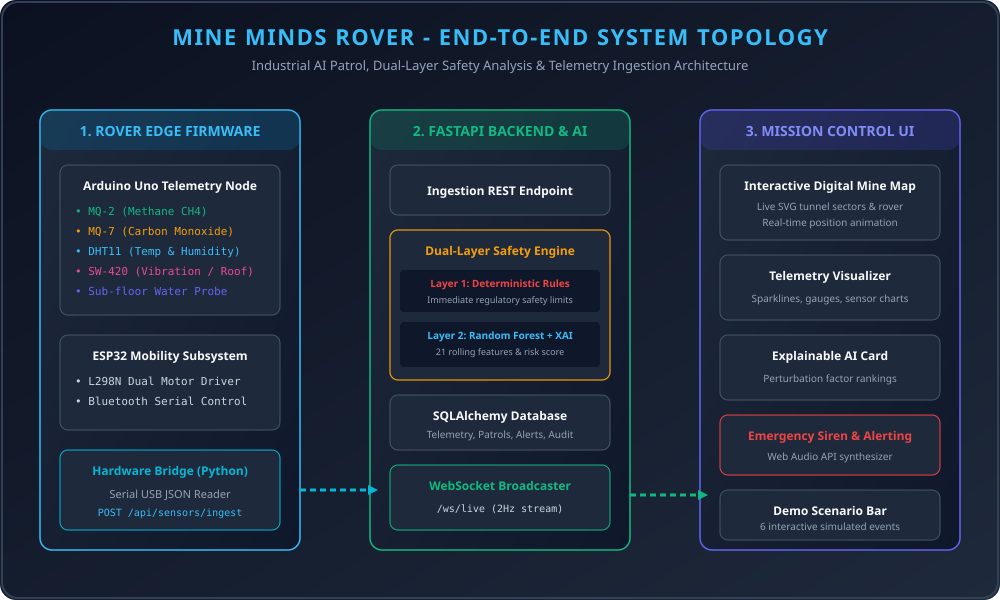
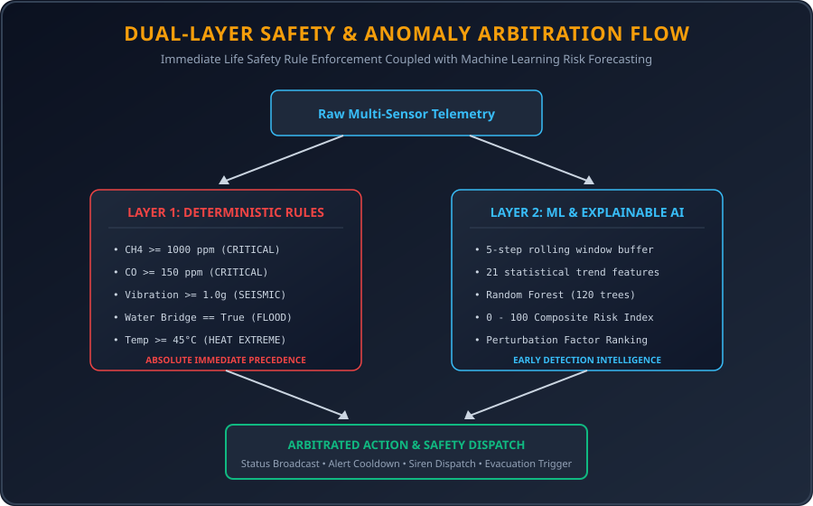

# 🪨 MINE MINDS: Autonomous Underground Mining Safety Rover & Digital Patrol System

[](https://fastapi.tiangolo.com)
[](https://reactjs.org)
[](https://www.typescriptlang.org)
[](https://scikit-learn.org)
[](https://tailwindcss.com)
[](https://www.docker.com)
[](LICENSE)

---

## 🎯 Executive Overview

> **"The rover doesn't just collect sensor readings. It creates an auditable digital patrol record of the underground mine. Safety authorities can monitor current conditions in real-time, track the rover's exact tunnel position, receive immediate dual-layer hazard alarms, understand explainable AI risk assessments, review historical safety trends, and generate regulatory PDF compliance reports."**

The **Mine Minds Rover** platform is an end-to-end industrial mission control, telemetry ingestion, and digital patrol system designed for underground mining operations. It combines embedded hardware (ESP32 locomotion + Arduino Uno environmental telemetry) with an asynchronous FastAPI backend and a React 18 TypeScript dashboard.

---

## 🏗️ System Architecture



The platform implements a **Dual-Layer Safety Architecture**:
- **Layer 1: Deterministic Safety Rule Engine**: Evaluates immediate regulatory limits ($CH_4 \ge 1000\text{ ppm}$, $CO \ge 150\text{ ppm}$, $\text{Vibration} \ge 1.0\text{g}$, $\text{Water}=\text{True}$, $\text{Temp} \ge 45^\circ\text{C}$). Takes absolute precedence for life-safety emergency alarms.
- **Layer 2: Machine Learning Random Forest & Explainable AI (XAI)**: Analyzes rolling 5-step time-series windows (21 engineered features) to detect gradient anomalies, computes a $0 - 100$ continuous composite risk score, and generates human-readable factor attributions (*"Why did the AI flag this sector?"*).



---

## ⚡ Technology Stack

### Backend & AI
- **API Framework**: Python 3.10+ / FastAPI with Asynchronous REST & WebSocket Endpoints
- **Database ORM**: SQLAlchemy 2.0 with SQLite / PostgreSQL support (12 relational models)
- **Machine Learning**: scikit-learn `RandomForestClassifier` (120 estimators, balanced weights, **100% Critical Recall**)
- **Explainable AI**: Feature perturbation ranking engine producing human-readable hazard explanations
- **Report Generation**: ReportLab automated PDF patrol reports & CSV telemetry streaming
- **Authentication**: OAuth2 Password Flow + JWT (HMAC-SHA256) + bcrypt role-based access control (`admin`, `supervisor`, `authority`)

### Frontend Dashboard
- **Framework**: React 18 with TypeScript & Vite
- **Styling**: Tailwind CSS (Industrial Safety High-Contrast Theme)
- **Real-Time Stream**: Native WebSocket client with automatic reconnection & state sync
- **Visualization**: Recharts (Multi-timescale time series 1m, 5m, 30m, 1h, 24h) + SVG Mine Topology Canvas
- **Audible Alerts**: Web Audio API Synthesizer for emergency sirens and chimes

### Embedded Hardware & Firmware
- **Sensors (Arduino Uno)**: MQ-2 (Methane/LPG), MQ-7 (Carbon Monoxide), DHT11/22 (Temp & Humidity), SW-420 (Vibration), Sub-floor Water Probe, Battery Divider
- **Chassis & Mobility (ESP32)**: L298N Dual H-Bridge DC Motor Driver with Bluetooth Serial command link (`ESP32_Car`)
- **Ingestion Gateway**: Python USB Serial to HTTP REST bridge forwarding packets to `/api/sensors/ingest`

---

## 📂 Repository Layout

```
mine-minds-rover/
├── backend/                            # FastAPI REST API, ML Engine & SQLite Database
│   ├── app/                            # Route controllers, schemas, models, services
│   ├── tests/                          # Pytest automated test suite (11/11 passing)
│   ├── seed.py                         # Realistic database demonstration seeder
│   ├── requirements.txt                # Python backend dependencies
│   └── Dockerfile                      # Backend container configuration
├── frontend/                           # React 18 + Vite + TypeScript Dashboard
│   ├── src/                            # Components, pages, contexts, audio service
│   ├── package.json                    # Node dependencies
│   ├── vite.config.ts                  # Vite bundler configuration
│   └── Dockerfile                      # Frontend container configuration
├── firmware/                           # Microcontroller Firmware
│   ├── esp32_motor_control/            # ESP32 Bluetooth Motor & Locomotion Firmware
│   └── arduino_sensor_node/            # Arduino Uno Environmental Sensor Telemetry
├── bridge/                             # Hardware Ingestion Gateway
│   ├── hardware_bridge.py              # USB Serial to REST API Forwarder
│   └── requirements.txt                # pyserial, requests
├── docs/                               # Detailed Technical Documentation
│   ├── architecture.md                 # System & Dual-Layer Safety Architecture
│   ├── hardware_wiring.md              # Wiring Schematics & Pin Tables
│   ├── api_reference.md                # REST & WebSocket API Specification
│   ├── ml_pipeline.md                  # Random Forest & XAI Pipeline Guide
│   └── deployment.md                   # Local, Docker & Production Setup
├── assets/                             # High-Resolution Vector SVG Diagrams
│   ├── system_architecture.svg         # Complete topology schematic
│   ├── dual_layer_safety_flow.svg      # Layer 1 + Layer 2 arbitration flow
│   └── hardware_wiring_diagram.svg     # Electrical pin connection diagram
├── docker-compose.yml                  # Multi-container stack orchestration
├── .env.example                        # Template environment variables
├── .gitignore                          # Industry-standard gitignore rules
├── LICENSE                             # MIT Open-Source License
└── README.md                           # Public repository overview
```

---

## 🚀 Quickstart

### Option 1: Local Development (Recommended)

#### 1. Backend Setup
```bash
cd backend
python -m pip install -r requirements.txt

# Train Random Forest classifier & seed demonstration records
python -m app.ml.train_model
python seed.py

# Launch FastAPI with live WebSocket broadcaster
uvicorn app.main:app --host 0.0.0.0 --port 8000 --reload
```
- Interactive Swagger API Docs: `http://localhost:8000/docs`
- Live WebSocket Channel: `ws://localhost:8000/ws/live`

#### 2. Frontend Setup
```bash
cd frontend
npm install
npm run dev
```
- Mission Control Dashboard: `http://localhost:5173`

#### 3. Hardware Bridge (Optional for Physical Sensors)
```bash
cd bridge
python hardware_bridge.py
```

---

### Option 2: Docker Compose

Launch the complete multi-container stack with a single command:
```bash
docker compose up --build
```
- Dashboard: `http://localhost:3000`
- Backend API: `http://localhost:8000`

---

## 🔑 Demo Login Credentials

The login screen provides one-click quick-login buttons for all 3 operational roles:

| Role | Username | Password | Permissions |
| :--- | :--- | :--- | :--- |
| **Admin** | `admin` | `admin123` | Full access, user & rover management, mine configuration, audit logs |
| **Mine Supervisor** | `supervisor` | `supervisor123` | Active sector surveillance, patrol control, alert acknowledgement |
| **Safety Authority** | `authority` | `authority123` | Multi-site compliance review, safety comparisons, official PDF reports |

---

## 🤖 6 Interactive Presentation Demo Scenarios

The dashboard includes a top-level **Scenario Control Bar** to simulate live underground mine safety events:

1. **`1. Normal Patrol`**: Nominal baseline telemetry across all zones ($CH_4 \approx 430\text{ ppm}$, $CO \approx 35\text{ ppm}$, Temp $27^\circ\text{C}$).
2. **`2. Methane Rising`**: Zone 03 methane climbs to $650\text{ ppm}$ -> triggers **ANOMALOUS** status & ML early warning with explanation.
3. **`3. Multi-Sensor Anomaly`**: Methane, Carbon Monoxide, and Temperature rise concurrently.
4. **`4. Critical Emergency`**: Methane spikes $>1200\text{ ppm}$ + Ground vibration $>1.2\text{g}$ -> triggers system-wide **EMERGENCY MODE**, audible siren, affected sector map zoom, and live camera feed.
5. **`5. Comm Lost`**: Heartbeat dropped -> System generates "Rover Offline" warning with elapsed time tracker.
6. **`6. Low Battery`**: Battery drops $<15\%$ -> Auto-return protocol triggered.

---

## 🧪 Automated Testing

Run the automated backend test suite:
```bash
cd backend
python -m pytest tests/ -v
```
All **11 tests pass** covering password hashing, JWT authorization, Layer 1 safety rules, Layer 2 Random Forest inference, sensor ingestion, mine lifecycles, and system health checks.

---

## 📚 Technical Documentation

- [System Architecture](docs/architecture.md)
- [Hardware Wiring & Electrical Schematics](docs/hardware_wiring.md)
- [API Reference & Telemetry Ingestion](docs/api_reference.md)
- [Machine Learning & Explainable AI Pipeline](docs/ml_pipeline.md)
- [Deployment & Operations Guide](docs/deployment.md)

---

## 📜 License

This project is licensed under the MIT License - see the [LICENSE](LICENSE) file for details.
